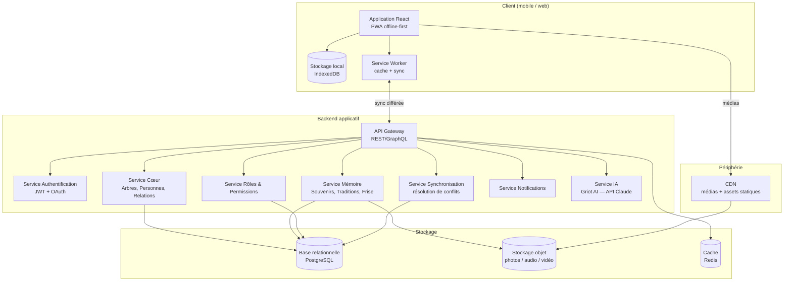
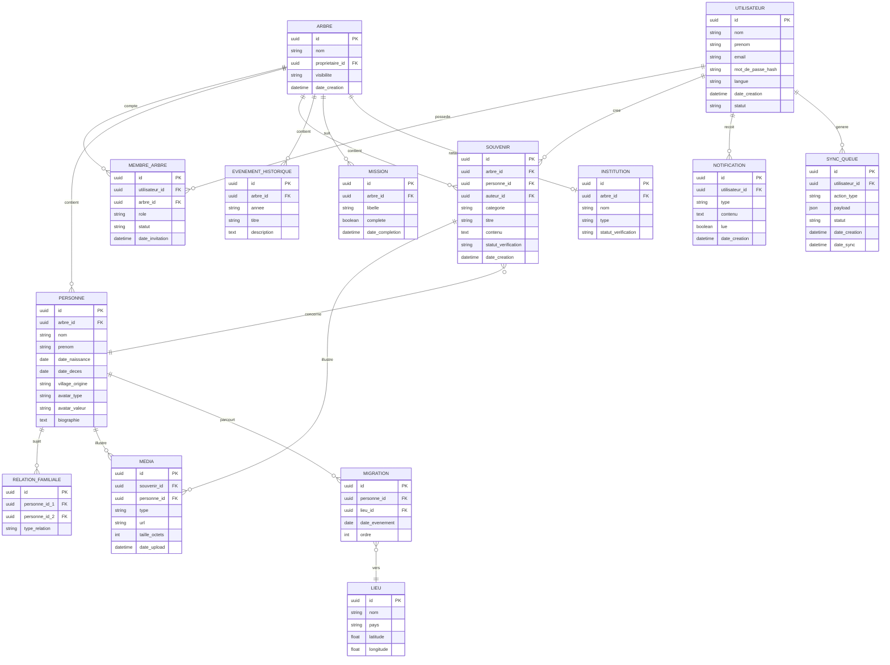
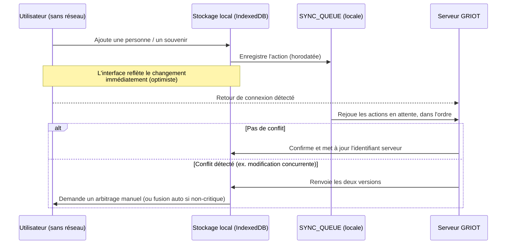

# GRIOT — Dossier de conception du Système d'Information

**Projet :** GRIOT — mémoire numérique des familles africaines
**Porté par :** GAM Labs
**Statut du document :** V1 — première version, à faire évoluer avec le projet
**Date :** 18 juillet 2026
**Document lié :** `GRIOT-MVP.md` (suivi du prototype de démonstration)

---

## Sommaire

1. Contexte et objectifs
2. Architecture globale du SI
3. Modélisation des données (MCD)
4. Dictionnaire de données
5. Acteurs et cas d'usage
6. Spécifications fonctionnelles par module
7. Gestion des rôles et permissions
8. Architecture du mode hors ligne
9. Sécurité et conformité
10. Infrastructure et déploiement
11. Roadmap technique

---

## 1. Contexte et objectifs

GRIOT est une plateforme de préservation de la mémoire familiale et culturelle, pensée pour les familles africaines et leurs diasporas. Le prototype de démonstration (interface uniquement, données fictives) a permis de valider le parcours utilisateur et le positionnement produit. Ce dossier définit le **système d'information cible** qui devra soutenir ces fonctionnalités en production.

**Contraintes de conception prioritaires**, issues des retours déjà collectés sur le prototype :

- **Connectivité intermittente** : une part significative des utilisateurs (villages, zones rurales) n'a pas d'accès réseau stable → le SI doit être pensé *offline-first*, pas *offline en option*.
- **Arbres de grande taille** : certaines familles dépassent 300 à 1000 personnes → le modèle de données et les requêtes doivent supporter la croissance sans dégrader les performances.
- **Collaboration multi-utilisateurs avec droits différenciés** : plusieurs membres d'une même famille contribuent au même arbre, avec des niveaux de confiance différents (administrateur, éditeur, contributeur, lecteur).
- **Contenus riches et sensibles** : photos, audio, vidéo, témoignages, documents d'état civil → contraintes de stockage, de modération et de protection des données personnelles.

---

## 2. Architecture globale du SI

**Principes directeurs :**

- L'application cliente fonctionne en **local-first** : toute action (ajout d'une personne, coche d'une mission, enregistrement d'un souvenir) est écrite immédiatement dans le stockage local, puis synchronisée dès qu'une connexion est disponible.
- L'API est découpée en **services fonctionnels** plutôt qu'en un monolithe, pour permettre une évolution indépendante (le service Mémoire, riche en médias, n'a pas les mêmes contraintes que le service Rôles, très transactionnel).
- Le service IA est isolé : il consomme l'API Claude pour les fonctionnalités d'assistance (résumé de témoignages, suggestions de proverbes, aide à la rédaction de biographies) déjà esquissées dans le prototype (« Griot AI »).

---

## 3. Modélisation des données (MCD)

**Points d'attention sur le modèle :**

- `RELATION_FAMILIALE` est volontairement une table pivot générique (`type_relation` = parent / enfant / conjoint) plutôt que des colonnes `pere_id` / `mere_id` sur `PERSONNE` : ça permet de représenter des familles recomposées, des unions multiples, et des configurations non strictement binaires — un vrai besoin identifié pour les familles africaines élargies.
- `AVATAR_TYPE` / `AVATAR_VALEUR` sur `PERSONNE` correspondent directement à ce qui a été maquetté dans le prototype (mode normal / avatar-icône / photo) : `avatar_type` ∈ {normal, avatar, image}, `avatar_valeur` stocke l'icône choisie ou l'URL média selon le cas.
- `SYNC_QUEUE` est la pièce centrale du mode hors ligne (détaillée en section 8) : chaque action effectuée sans réseau y est journalisée avant d'être rejouée côté serveur.

---

## 4. Dictionnaire de données (extrait — entités clés)

| Entité | Champ | Type | Contrainte | Description |
|---|---|---|---|---|
| PERSONNE | avatar_type | enum | normal / avatar / image | Mode d'affichage choisi, cf. prototype |
| PERSONNE | avatar_valeur | string | nullable | Emoji/icône si `avatar`, URL si `image` |
| MEMBRE_ARBRE | role | enum | admin / editeur / contributeur / lecteur | Cf. section 7 |
| MEMBRE_ARBRE | statut | enum | actif / invité / en_attente | |
| SOUVENIR | categorie | enum | histoire / cuisine / danse / musique / proverbe / mariage / funerailles / naissance / vetements / rituel | Reprend les catégories de traditions du prototype |
| SOUVENIR | statut_verification | enum | non_verifie / verifie_famille / verifie_chefferie | Contrôle de fiabilité des contenus |
| SYNC_QUEUE | action_type | enum | creation / modification / suppression | |
| SYNC_QUEUE | statut | enum | en_attente / synchronise / conflit | |

*(dictionnaire complet à étoffer au fil du développement — ce tableau couvre les champs qui ne sont pas auto-explicites)*

---

## 5. Acteurs et cas d'usage principaux

| Acteur | Cas d'usage clés |
|---|---|
| **Visiteur** | Découvrir le produit, créer un compte, rejoindre un arbre existant via invitation |
| **Contributeur** | Proposer l'ajout d'une personne ou d'un souvenir (soumis à validation) |
| **Éditeur** | Ajouter/modifier des personnes, valider des propositions, enregistrer des souvenirs |
| **Administrateur** | Gérer les membres et leurs rôles, paramétrer l'arbre, exporter les données |
| **Institution (chefferie)** | Certifier des informations, consulter l'espace institutionnel |
| **Système (offline)** | Mettre en file les actions hors ligne, les rejouer et résoudre les conflits au retour réseau |

---

## 6. Spécifications fonctionnelles par module

Reprise des écrans déjà maquettés, avec ce qu'implique chacun côté SI :

| Écran (prototype) | Entités mobilisées | Besoin SI principal |
|---|---|---|
| Créer un compte | UTILISATEUR | Authentification, vérification email/téléphone |
| Tableau de bord | ARBRE, MISSION, MEMBRE_ARBRE, NOTIFICATION | Agrégation de données multi-sources, calcul du score de complétude |
| Arbre généalogique | PERSONNE, RELATION_FAMILIALE | Requêtes de parcours de graphe familial, pagination pour grands arbres |
| Fiche personne | PERSONNE, MEDIA, EVENEMENT_HISTORIQUE | Stockage et diffusion de médias (CDN) |
| Rôles & permissions | MEMBRE_ARBRE | Contrôle d'accès (RBAC), invitations |
| Carte des origines | MIGRATION, LIEU | Géolocalisation, agrégation temporelle |
| Mémoire familiale | SOUVENIR, MEDIA, EVENEMENT_HISTORIQUE | Modération de contenu, catégorisation, recherche |
| Espace chefferie | INSTITUTION | Certification/validation externe |
| Mode hors ligne | SYNC_QUEUE | File d'attente, résolution de conflits |

---

## 7. Gestion des rôles et permissions

Reprise fidèle de la matrice définie dans le prototype, à implémenter en RBAC (Role-Based Access Control) côté API — chaque endpoint vérifie le rôle de l'utilisateur sur l'`ARBRE` concerné (et non un rôle global) :

| Rôle | Lecture | Proposer (contribution) | Modifier directement | Valider une proposition | Gérer les membres |
|---|:---:|:---:|:---:|:---:|:---:|
| Lecteur | ✅ | ❌ | ❌ | ❌ | ❌ |
| Contributeur | ✅ | ✅ | ❌ | ❌ | ❌ |
| Éditeur | ✅ | ✅ | ✅ | ✅ | ❌ |
| Administrateur | ✅ | ✅ | ✅ | ✅ | ✅ |

Une contribution d'un **Contributeur** crée un enregistrement en attente (`statut_verification = non_verifie`) qui n'est visible publiquement qu'après validation par un Éditeur ou un Administrateur — cette mécanique alimente aussi le futur système de notifications (« Marie a proposé un ajout, à valider »).

---

## 8. Architecture du mode hors ligne

**Règles de résolution de conflits proposées :**

- **Créations** (nouvelle personne, nouveau souvenir) : jamais de conflit, un nouvel identifiant serveur est simplement attribué.
- **Modifications sur un même champ par deux utilisateurs différents hors ligne** : la version la plus récente (horodatage) est appliquée automatiquement pour les champs non critiques (village, biographie) ; les champs critiques (dates de naissance/décès, suppression) déclenchent une **validation manuelle** par un Éditeur ou Administrateur.
- **Suppressions** : jamais de suppression définitive en cascade automatique hors ligne — une suppression proposée hors ligne passe en statut « à confirmer » au retour réseau.

---

## 9. Sécurité et conformité

Points de vigilance identifiés dès la conception, en cohérence avec une approche de gouvernance de la sécurité de l'information :

- **Authentification** : JWT à courte durée de vie + refresh token, option MFA pour les comptes Administrateur.
- **Chiffrement** : TLS en transit, chiffrement au repos pour les champs sensibles (données de mineurs présents dans l'arbre, documents d'état civil).
- **Protection des données personnelles** : les arbres familiaux contiennent des données sur des personnes n'ayant pas nécessairement consenti elles-mêmes (proches décédés, mineurs) → politique de consentement du propriétaire d'arbre à documenter, droit à l'effacement à prévoir dès le MLD (suppression en cascade contrôlée).
- **Journalisation** : toute modification d'une `PERSONNE` ou d'un `SOUVENIR` doit être tracée (auteur, date, valeur précédente) pour permettre l'audit et la restauration — utile aussi en cas de vandalisme sur un arbre partagé.
- **Modération** : les contenus de type `SOUVENIR` avec médias doivent passer par une modération automatique a minima (détection de contenu inapproprié) avant diffusion publique.
- **Résidence des données** : à trancher selon les marchés cibles (Cameroun, Gabon, Congo + diaspora Europe/Amérique du Nord) — probable nécessité d'une architecture multi-région.

*(Ce point mérite un chantier dédié à part entière, en cohérence avec ton profil d'auditrice SI — je peux le développer en dossier de sécurité séparé si utile, sur le modèle ISO 27001 déjà utilisé pour CyberGov.)*

---

## 10. Infrastructure et déploiement

| Composant | Choix proposé | Justification |
|---|---|---|
| Hébergement API | Cloud (conteneurs, ex. Kubernetes) | Scalabilité, cohérent avec l'expérience déjà acquise sur d'autres projets |
| Base de données | PostgreSQL managé | Relationnel robuste, support JSON pour les champs flexibles (payload de sync) |
| Stockage médias | Object storage compatible S3 | Coût maîtrisé pour gros volumes photo/audio/vidéo |
| CDN | Distribution géographique | Réduction de la latence pour la diaspora comme pour l'Afrique |
| Client | PWA (Progressive Web App) | Un seul code base, installable, fonctionne hors ligne nativement |
| CI/CD | Pipeline automatisé | Déploiements fréquents et fiables |

---

## 11. Roadmap technique

| Lot | Contenu | Dépendances |
|---|---|---|
| **Lot 1 — Socle** | Authentification, modèle ARBRE/PERSONNE/RELATION, CRUD de base | — |
| **Lot 2 — Collaboration** | Rôles & permissions, invitations, propositions/validations | Lot 1 |
| **Lot 3 — Mémoire** | Souvenirs, médias, catégories de traditions, frise historique | Lot 1 |
| **Lot 4 — Hors ligne** | Service Worker, IndexedDB, SYNC_QUEUE, résolution de conflits | Lots 1-3 |
| **Lot 5 — Carte & migrations** | Géolocalisation, visualisation des parcours | Lot 1 |
| **Lot 6 — IA (Griot AI)** | Intégration API Claude pour assistance à la saisie | Lots 1-3 |
| **Lot 7 — Moteur de navigation d'arbre** | Zoom infini, regroupement, recherche pour grands arbres (300-1000+ personnes) | Lot 1, à ne pas sous-estimer |

---

*Document vivant — à mettre à jour à chaque décision de conception structurante, en miroir du `GRIOT-MVP.md` qui suit le prototype.*
