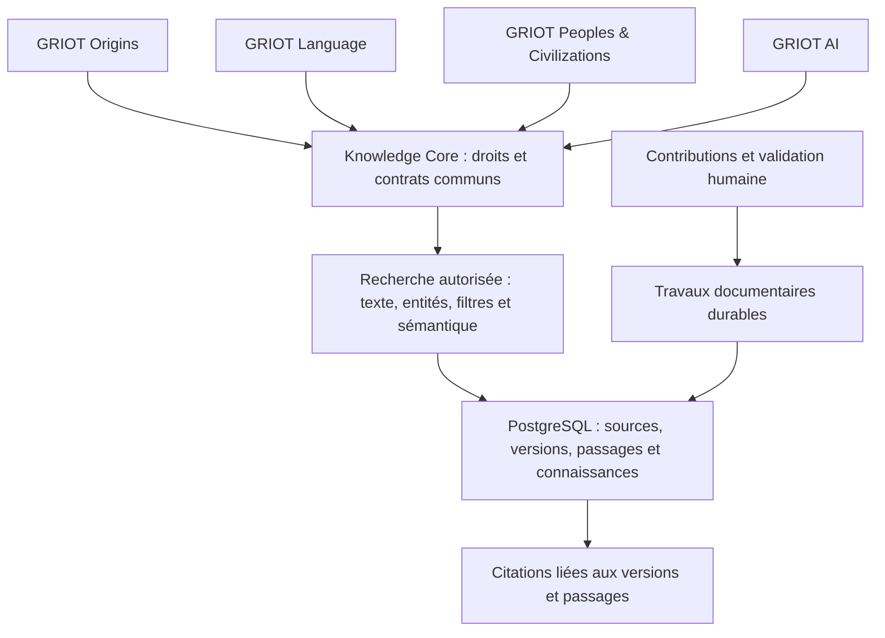
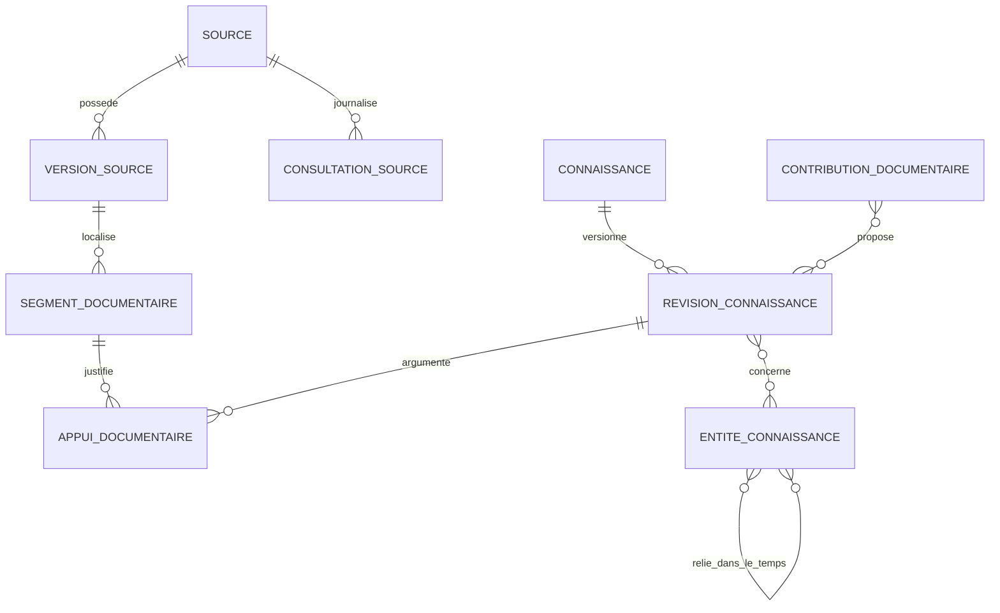

# Architecture proposée — GRIOT Knowledge Core

**Proposition soumise à validation. Aucun des composants nouveaux décrits ici n’est implémenté.**

## 1. Un référentiel, trois usages

Knowledge Core devient un module NestJS transversal. PostgreSQL reste la source de vérité ; les index et copies hors ligne sont des dérivés reconstruisibles. Origins, Language et Peoples & Civilizations interrogent les mêmes identifiants, versions et passages. Ils ne maintiennent pas trois copies autonomes des références.

Deux périmètres restent distincts dans ce même système : le corpus éditorial public et les ressources d’un arbre privé. Le partage entre modules ne signifie pas partage entre familles. L’index et les résultats sont filtrés selon les droits avant classement et génération.

## 2. Modèle conceptuel et réutilisation

Les noms suivent les conventions françaises de la base existante. Les tables d’association explicites et contraintes finales seront précisées avant la migration ; cette section ne constitue pas un schéma Prisma à appliquer.

| Entité logique | Traitement proposé | Données et relations principales |
| --- | --- | --- |
| `Source` | Enrichir l’existant | Identité bibliographique, titre, auteurs, organisme, type documentaire, nature primaire/secondaire/tertiaire/inconnue, publication, langue, identifiants, URL, droits, périmètre, statut documentaire |
| `VersionSource` | Nouvelle | Source, numéro de version, empreinte du contenu effectivement obtenu, fichier autorisé éventuel, conditions d’accès, date, motif et état ; les anciennes versions ne sont pas écrasées |
| `ConsultationSource` | Nouvelle | Source/version, acteur ou tâche, heure, méthode, résultat, URL finale, disponibilité, contenu réellement consulté et éventuel changement détecté |
| `SegmentDocumentaire` | Nouvelle | Version de source, texte autorisé ou description, page/section/position/temps audio, méthode d’extraction, langue, contrôle de qualité et statut |
| `Connaissance` et `RevisionConnaissance` | Nouvelles | Identité stable puis texte d’une assertion, qualification, dates/périodes, langue, état de validation, auteur/relecteur, motif, périmètre ; révisions immuables une fois publiées |
| `AppuiDocumentaire` | Nouvelle | Relation N–N entre une révision et un passage précis ; soutien, contradiction ou contexte, argument et limites ; plusieurs appuis par assertion |
| `RelationConnaissance` | Nouvelle | Liens explicites entre révisions : contredit, nuance, corrige, complète ; argument sourcé et périmètre compatible |
| `EntiteConnaissance` et ses relations | Nouvelles | Identité canonique d’un lieu, événement, période, peuple, civilisation, langue, variété ou mouvement collectif ; identifiants externes, noms contextualisés, relations datées et liens aux assertions |
| `ThemeConnaissance` et associations | Nouvelles | Thèmes contrôlés, hiérarchie éventuelle, liens vers sources, entités et révisions |
| `RessourceDocumentaire` | Nouvelle | Ressource pédagogique, dictionnaire, grammaire, audio, image ou carte ; lien à la source/version/variété et droits, sans recopier chaque connaissance dans chaque module |
| `ContributionDocumentaire` | Nouvelle | Auteur, arbre/périmètre, proposition, droits déclarés, provenance, état de modération, décisions et liens vers les révisions issues de sa validation |
| `HabilitationDocumentaire` | Nouvelle | Utilisateur, mission de curation/relecture, portée et révocation ; indépendante des rôles d’un arbre ou du groupe GitLab |
| `JournalDocumentaire` | Nouvelle | Acteur, action, cible/version, date, raison, périmètre et éléments d’audit minimaux ; pas de copie systématique des données privées dans les logs |
| `TacheDocumentaire` | Nouvelle | Travail d’import, extraction, indexation ou contrôle, état, tentative, bail d’exécution, échéance, résultat et clé d’idempotence |

`Preuve`, `Personne`, `Souvenir`, `Migration`, `Lieu`, `CarteLangue` et `Media` conservent leur fonction actuelle. Une preuve familiale peut référencer une source centrale autorisée ; elle ne devient pas automatiquement un `AppuiDocumentaire` scientifique. Un média privé n’est pas transformé en ressource globale. Les fichiers documentaires pourront réutiliser le stockage Blob privé derrière un service contrôlé et un espace de chemins séparé, sans détourner les droits des médias de personnes.

Les cinq catégories documentaires sont des vues et types contrôlés de ce modèle commun, pas cinq bases. Des types et attributs spécifiques versionnés permettent l’extension sans refaire le noyau. Identifiants, droits, intervalles, relations et champs interrogés fréquemment restent structurés ; un JSON libre ne remplace pas toutes les contraintes. Les types et attributs nouveaux sont administrés et validés, pas définis par du texte importé.

### Bibliographie, identifiants et déduplication

Une source possède un UUID GRIOT ; les DOI, ISBN avec édition, identifiants d’archive et URLs sont des identifiants externes. Une URL n’est ni une consultation ni une preuve. Un ISBN commun n’annule pas les différences d’édition ; une traduction n’est pas un second témoin indépendant par défaut.

Dédupliquer d’abord sur un identifiant bibliographique normalisé ou une identité de document confirmée, puis sur l’empreinte des octets réellement acquis. La normalisation d’URL conserve les paramètres qui changent le document. Un doublon probable produit une suggestion humaine ; une fusion conserve alias, versions, relations et historique. Les valeurs inconnues restent inconnues.

La contrainte de déduplication inclut un périmètre non nul (`public` ou `arbre:<id>`) : un fichier privé identique dans deux familles n’autorise pas un lien révélant son existence, son titre ou son contenu. Réutiliser une source publique est possible depuis chaque arbre ; publier un fichier ou témoignage privé exige un consentement et une décision distincts. Pour les anciennes sources éventuellement reliées à plusieurs arbres, conserver un état restreint et des liens d’accès issus des preuves ; ne jamais leur donner par défaut une portée publique.

### Entités historiques, culturelles et linguistiques

Une entité géographique peut représenter une ville actuelle ou un territoire historique. Les noms, frontières et appartenances portent leur période de validité et leur provenance ; une frontière actuelle ne sert pas à conclure rétroactivement à une nationalité. Un lieu familial ne reçoit un identifiant canonique qu’après une correspondance suffisamment précise et, si ambiguë, confirmation humaine.

Les périodes utilisent des intervalles et une précision explicite (jour, année, siècle, approximative, inconnue), pas seulement une date exacte imposée. Prévoir des années avant notre ère et conserver le calendrier de la source ; la convention d’année interne et sa conversion doivent être fixées avant le schéma physique. Une borne inconnue ne devient pas une date inventée. Les requêtes signalent les rapprochements chronologiques incertains.

Les relations entre peuple, langue, variété, clan, territoire ou diaspora sont typées, datées et justifiées. « Parlé dans », « apparenté linguistiquement » et « identité déclarée » ne sont pas des équivalences. Aucun patronyme, pays, langue ou trajet familial ne déclenche une attribution automatique d’ethnie, de tribu ou de clan. `Migration` reste une présence personnelle ; un mouvement migratoire collectif documenté est une entité distincte, reliée seulement lorsqu’une preuve le permet.

## 3. Sources, consultations et droits

Le registre conserve, quand disponibles : titre, auteurs, organisme, type, publication, langue, territoires/périodes/thèmes, référence d’archive ou URL, nature primaire/secondaire/tertiaire, licence et usages permis, statut, dernière vérification et historique de consultation. Les informations absentes ne sont pas complétées par invention.

Les opérations sont distinctes :

1. **Identifier** une référence : métadonnées et provenance de sa découverte.
2. **Contrôler l’accès** : tentative datée et résultat ; une réponse HTTP ou un contrôle HEAD ne vaut pas lecture du document.
3. **Consulter/acquérir** le contenu autorisé : preuve de la méthode et version identifiée. Un résultat de moteur de recherche reste une piste, pas le document consulté.
4. **Extraire** : seulement ce que permettent les droits, avec pages/sections/repères audio et qualité OCR éventuelle.
5. **Structurer et relire** les assertions : conserver l’appui exact et les limites.
6. **Publier/indexer** une révision autorisée après décision ; une sortie d’extraction automatique reste en attente jusque-là.

Pour un document à droits inconnus ou restreints : conserver les métadonnées, un lien et une analyse/reformulation autorisée, sans copier intégralement le texte ni l’envoyer à un modèle externe. Les citations courtes restent soumises aux usages autorisés. Les témoignages et enregistrements portent les consentements de conservation, partage, extraction et éventuel traitement externe. Une licence connue ne supprime pas le contrôle des données personnelles.

Les locators distinguent page imprimée et page PDF, numéro de section, offset de texte ou timecode. Un passage de 30 secondes d’audio ne devient pas une page imaginaire. Une référence est liée à une version stable ; un décalage de page ou de texte après mise à jour impose un nouvel ancrage.

Le modèle de provenance s’inspire de [W3C PROV](https://www.w3.org/TR/prov-overview/) pour relier entités, activités et acteurs ; les ancrages peuvent suivre les principes de [Web Annotation](https://www.w3.org/TR/annotation-model/). Aucun triplestore ni standard de sérialisation n’est imposé pour ce premier développement.

## 4. Statuts et contradictions

| Dimension | Valeurs proposées | Ce que cela ne prouve pas |
| --- | --- | --- |
| Statut documentaire | À examiner, source identifiée, contenu extrait, en attente de vérification, vérifié, contesté, obsolète, archivé | La vérité de chaque assertion du document |
| Accessibilité | Non contrôlée, accessible, accès restreint, indisponible, modifiée | La lecture ou l’approbation scientifique |
| Qualification d’une assertion | Fait documenté, interprétation scientifique, témoignage, tradition orale, hypothèse, information incertaine | Une certitude universelle ou l’identité d’une personne |
| Validation d’une révision | Brouillon, à relire, validée éditorialement, contestée, retirée | L’absence de biais dans une source primaire ou officielle |
| Décision familiale existante | Non vérifié, vérifié en famille/chefferie | La validation du corpus de référence public |

Chaque changement de statut a un acteur, une date, un motif et une cible versionnée. « Vérifié » désigne les contrôles réellement effectués et leurs limites. Un document modifié ou devenu indisponible ne réécrit pas silencieusement une assertion publiée ; il déclenche une réévaluation. Une réponse fondée sur une ancienne version encore légalement conservée indique sa date et son état d’accès.

Les appuis portent une relation à la source : soutien, contradiction ou contexte. Deux sources qui recopient un même texte sont reliées par une dépendance/collection d’origine ; elles ne comptent pas comme deux confirmations indépendantes. L’indépendance inconnue reste signalée. Un score de pertinence de recherche n’est pas un pourcentage de vérité.

Les désaccords sont présentés avec les versions, périodes, méthodes et arguments concernés. Il faut vérifier qu’il s’agit bien de la même affirmation dans le même contexte avant de conclure à une contradiction. Les versions minoritaires ou contestées ne sont ni supprimées automatiquement ni rendues équivalentes sans examen de leurs appuis.

## 5. Recherche commune et RAG

### Contrat de recherche envisagé

Une demande contient la question (longueur bornée), le module, la langue d’interface et les filtres facultatifs : entité géographique, période, thème, langue/variété et nature/type de source. Pour le contexte familial, le client peut proposer un arbre, mais **le serveur calcule les droits** ; il ne reçoit pas une liste de périmètres autorisés supposée fiable.

La réponse de recherche contient les révisions pertinentes, leurs passages et identifiants de citation, les filtres effectivement appliqués, les limites de couverture, l’état du référentiel et un curseur borné. Les métadonnées de classement ne deviennent pas un score de fiabilité scientifique.

### Chaîne attendue

1. Identifier l’utilisateur et son accès actif ; résoudre le périmètre documentaire avant toute recherche.
2. Détecter les domaines et extraire dates, lieux, langues et autres entités comme **candidats**. Une ambiguïté appelle une précision, pas un lien arbitraire.
3. Interroger les révisions autorisées et admissibles : texte, identifiants exacts et filtres structurés.
4. Compléter par une recherche sémantique dans le même périmètre, si son adaptateur a été validé. En son absence, annoncer la recherche lexicale limitée ; ne pas prétendre fournir un RAG hybride complet.
5. Fusionner les résultats, dédupliquer leurs origines et sélectionner les passages avec leurs contradictions et limites, dans un budget borné.
6. Construire un paquet documentaire sans instruction exécutable issue des documents. N’y inclure que les extraits dont l’usage est permis.
7. Fournir à GRIOT AI ces passages et identifiants de citation. La génération reste optionnelle et désactivée tant qu’aucun modèle/fournisseur n’est validé ; la restitution structurée reste possible.
8. Vérifier que chaque citation retournée appartient au paquet, correspond à la version et soutient réellement la phrase. Une vérification d’identifiant seule ne suffit pas à établir le soutien sémantique ; inclure une recette humaine sur un corpus annoté.
9. Rendre les faits documentés, interprétations, hypothèses et désaccords distincts. Si les appuis manquent, produire un état **documentation insuffisante**.

Une recherche complémentaire est une capacité séparée, disponible seulement si un connecteur est configuré et son usage autorisé. Aujourd’hui GRIOT n’en possède pas. Son résultat rejoint le processus d’identification/consultation/relecture ; une nouvelle page trouvée ne rejoint pas directement les faits validés. Aucun résultat de recherche n’est inventé.

### Indexation et sémantique

Commencer par les index d’identifiants, périmètres, statuts, versions, langues et périodes, puis une recherche textuelle PostgreSQL adaptée aux langues des passages. [PostgreSQL 16 permet d’indexer la recherche plein texte](https://www.postgresql.org/docs/16/textsearch-tables.html). Le fang et les autres langues peu dotées exigent des essais spécifiques : conserver les graphies et tons, prévoir les alias contrôlés et ne pas supposer qu’un analyseur français couvre leurs besoins.

L’architecture prévoit un adaptateur sémantique à évaluer sur des questions annotées et multilingues. Avant de choisir : vérifier les extensions de production, qualité en fang et mandarin, coût d’encodage, confidentialité, latence et portabilité. `pgvector` dans le PostgreSQL existant est une option à étudier, pas une dépendance installée ou décidée. Un moteur externe n’est retenu que si un besoin mesuré le justifie. Les index dérivés enregistrent version du texte, modèle, dimensions et paramètres ; un changement de modèle ne mélange pas silencieusement des vecteurs incompatibles.

Les tables sont communes aux trois modules. Des adaptateurs servent les faits historiques à Origins, les ressources/variantes à Language et les relations culturelles contextualisées à Peoples & Civilizations. Un pack pédagogique ou une donnée hors ligne référence une version du Core, sans devenir un quatrième corpus éditorial autonome.

## 6. Citations et exemple de comportement

Chaque assertion de réponse possède des références structurées : source, version, passage/repère, titre, auteur ou organisme, date disponible, URL publique ou accès contrôlé, relation soutien/contradiction et limites. L’affichage place la référence auprès de l’affirmation correspondante. Pas de page, de DOI, d’auteur ou de date générés par le modèle pour compléter une donnée absente.

Pour « Mon grand-père était en Éthiopie puis au Cameroun, pourquoi ? » : les présences familiales autorisées restent des faits déclarés dans l’arbre ; un événement national documenté peut éclairer la période. Sans témoignage ou document reliant explicitement le départ à cet événement, la réponse indique que le motif individuel reste inconnu. Les questions sur un possible motif sont des pistes d’enquête, jamais une prédiction chiffrée. Un rapprochement langue/peuple ne produit pas une attribution d’identité.

## 7. Contributions et gouvernance

| Acteur | Droits envisagés |
| --- | --- |
| Visiteur | Consulter seulement le corpus éditorial publié et les présentations explicitement autorisées ; pas les documents sources privés d’un arbre |
| Membre actif | Rechercher les ressources auxquelles son arbre lui donne droit, selon les rôles existants |
| Contributeur familial autorisé | Proposer une source, correction ou tradition orale dans son arbre ; la proposition reste hors du corpus de référence |
| Éditeur/admin d’arbre | Modérer les contributions de son arbre ; pas de pouvoir implicite sur la connaissance scientifique globale |
| Curateur habilité | Préparer des sources et révisions dans son périmètre éditorial |
| Validateur documentaire habilité | Relire et décider des révisions de référence, avec justification ; les sujets sensibles/contradictoires demandent une seconde relecture adaptée |
| Administrateur documentaire habilité | Gérer types, habilitations et politiques, avec journalisation ; les droits ne sont pas attribués par une instruction contenue dans un document |

Les habilitations et leur premier titulaire sont une décision explicite de la responsable du projet. Être membre du groupe GitLab ne confère pas un rôle dans l’application. Une contribution validée en famille ne passe pas automatiquement dans le corpus public. La promotion éventuelle est une décision tracée, avec droits de diffusion et consentement adaptés.

## 8. Sécurité, confidentialité et cache

- Reprendre l’appartenance active et les contrôles de rôle existants. Le Core applique ces contrôles au niveau du service, y compris pour les appels internes, citations, exports et travaux asynchrones.
- Filtrer les candidats en base et dans l’index **avant** la sélection des passages et le calcul des résultats exposés. Retirer après coup des passages privés d’un top-k global ne constitue pas une isolation suffisante.
- Vérifier à nouveau l’accès au document lors de l’ouverture d’une citation. Ne pas exposer titre, résumé, vecteur, nombre de résultats ou URL de fichier non autorisés. Les logs et traces de prompts excluent le contenu familial brut par défaut.
- Un cache public ne contient que des réponses sur corpus public sans contexte familial. Le cache privé inclut utilisateur/arbre, révision des droits, filtres, versions du corpus et du moteur. Invalider aussi après changement d’accès, retrait d’une source ou révision, pas seulement après expiration.
- Aucun envoi de données privées vers un modèle externe par défaut. Un fournisseur futur nécessite un choix explicite, une politique de traitement et les autorisations correspondantes ; les données ne deviennent pas un jeu d’entraînement implicite.
- À l’ingestion, les documents sont des données non fiables : aucune instruction, macro ou script importé n’est exécuté. Extraction bornée, fichiers contrôlés par signature, quarantaine et traitement isolé ; limites d’octets, pages, durée et décompression avant parsage.
- Un collecteur d’URL doit prévenir les SSRF : destinations admises, blocage des IP internes/métadonnées et schémas non autorisés, contrôle DNS et de chaque redirection, temporisation et taille bornées. Ces contrôles suivent les [principes OWASP SSRF](https://cheatsheetseries.owasp.org/cheatsheets/Server_Side_Request_Forgery_Prevention_Cheat_Sheet.html). Aucun collecteur n’est activé par ce dossier.
- Aucune instruction dans un document ne peut changer les permissions, choisir un outil, publier un contenu ou obtenir un secret. La recherche complémentaire et l’accès réseau restent des opérations serveur contrôlées, séparées de la génération.

Les durées de conservation sont configurées par classe : métadonnées, contenus copiés, audio consenti, traces et caches. Les versions utiles à la traçabilité sont conservées si les droits le permettent ; une révocation ou obligation d’effacement retire les copies/index/caches concernés et conserve seulement un tombstone minimal légalement admissible. « Historique immuable » ne signifie pas conservation indéfinie d’un document privé ou sous licence révoquée.

## 9. Traitements longs, coûts et maintenance

Une API crée un travail durable et retourne son état ; un exécuteur borné prend un bail, écrit un résultat et peut reprendre sans duplication. Les baux expirés, échecs temporaires, annulations, quotas et reprises sont explicites. La file documentaire est distincte de `SyncQueue`, qui représente la synchronisation familiale existante. Le choix concret de l’exécuteur et de son hébergement reste ouvert.

Les requêtes Vercel ont des limites de durée et de charge : leur configuration actuelle doit être vérifiée avant de dimensionner l’extraction. Un import volumineux ne doit pas dépendre d’un processus non durable lancé après une réponse HTTP. Référence de conception : [limites officielles Vercel Functions](https://vercel.com/docs/functions/limitations), consultées pour cette proposition ; aucun plafond chiffré n’est supposé applicable au plan du projet.

Prévoir : déduplication avant encodage, indexation des seules versions modifiées, cache de résultats publics versionné, packs offline choisis, pagination, limites par recherche et par import, budget de passages/tokens, quotas par tâche, compteur d’appels et de dépenses par fournisseur, arrêt contrôlé quand un budget est atteint. Les montants et objectifs de latence seront validés avec un volume de recette ; ils ne sont pas promis sans mesure.

Les contrôles périodiques des sources enregistrent disponibilité, date et changement possible ; ETag ou Last-Modified sont des indices, pas une preuve de contenu inchangé. Une nouvelle empreinte exige un contenu effectivement obtenu. Une disparition ne supprime pas l’historique ; une modification ne remplace pas silencieusement la version citée. Les dépendances entre versions, assertions, index et caches déclenchent des réévaluations ciblées.

## 10. Reprise progressive et compatibilité

1. Inventorier les références déjà dans le code avec leur origine ; les importer comme identifiées/à examiner, pas comme nouvellement consultées ou vérifiées.
2. Enrichir `Source` sans supprimer ses champs ni rompre les relations de `Preuve`. Les anciens documents privés et les sources à périmètre incertain restent restreints tant que leur accès n’est pas résolu.
3. Créer les versions, consultations et passages nécessaires à un premier corpus pilote autorisé ; relire les appuis avant publication.
4. Ajouter les contrats de recherche/citations et les adaptateurs en lecture, derrière activation progressive ; conserver les réponses existantes si le nouveau corpus est indisponible.
5. Connecter Origins, puis les références et ressources de Language, puis les vues Peoples & Civilizations et les réponses documentaires de GRIOT AI. Conserver l’API et les identifiants de cours/progrès existants.
6. Garder les JSON existants comme dérivés de distribution ou solutions de transition ; à terme leur publication part d’une version du Core. Une seule origine éditoriale, plusieurs formats de lecture.

Avant chaque lot : migration additive réversible, sauvegarde/recette de restauration si nécessaire, limites de volume, stratégie de désactivation et tests de non-régression. Rien n’est activé ou migré avant validation de la présente architecture.
